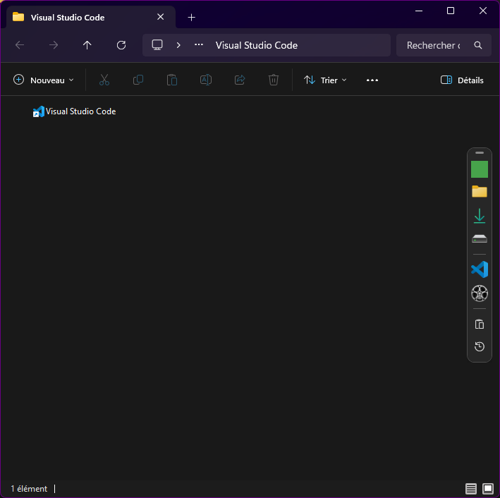
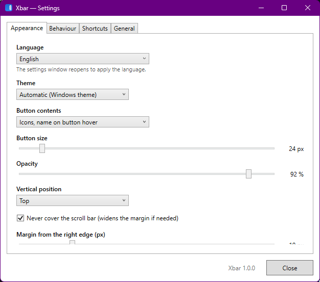

# Xbar

**Une barre de raccourcis qui vit à l'intérieur de vos fenêtres de l'Explorateur Windows 11.**

*[Read this document in English](README.md)*



Xbar ajoute une fine barre verticale juste à l'intérieur du bord droit de chaque fenêtre de
l'Explorateur. Épinglez-y les dossiers, fichiers et applications que vous ouvrez toute la
journée, et atteignez-les sans quitter la fenêtre où vous êtes déjà.

Xbar n'injecte rien dans `explorer.exe`, ne le modifie pas, et ne demande jamais de droits
administrateur.

---

## Téléchargement

1. Récupérez **`Xbar.exe`** dans la [dernière version](https://github.com/lakpo/Xbar/releases/latest).
2. Placez-le où vous voulez — `C:\Users\<vous>\Apps\Xbar\` fait très bien l'affaire.
3. Double-cliquez dessus.

C'est toute l'installation. Pas d'assistant, pas de runtime à installer, rien d'écrit en dehors
de votre profil utilisateur. Xbar apparaît dans la zone de notification et une barre s'affiche
dans chaque fenêtre de l'Explorateur ouverte.

> Windows peut afficher un avertissement **SmartScreen** au premier lancement, le fichier
> n'étant pas signé. Cliquez sur *Informations complémentaires* → *Exécuter quand même*.

**Vous préférez un dossier autonome ?** Téléchargez `Xbar-<version>-portable.zip` depuis la même
version et décompressez-le n'importe où, clé USB comprise. Dans ce mode, Xbar garde tout dans un
dossier `Data\` à côté de l'exécutable et n'écrit rien d'autre sur la machine.

| | Emplacement des réglages | Démarre avec Windows |
|---|---|---|
| `Xbar.exe` seul | `%AppData%\Xbar\` | oui, dès le premier lancement |
| Zip portable | `Data\` à côté de l'exe | non — à activer depuis l'icône de notification |

Pour désinstaller : quittez Xbar depuis l'icône de notification, supprimez l'exécutable, et au
besoin le dossier `%AppData%\Xbar\`.

**Prérequis :** Windows 11 (build 22000 ou ultérieure), 64 bits. Aucune installation de .NET.

---

## Prise en main

**Ajouter un raccourci** — glissez un dossier, un fichier, une application ou un `.lnk` sur la
barre. Ou clic droit sur la barre → *Ajouter*, ou depuis la fenêtre Paramètres.

**Utiliser un raccourci de dossier**

| Geste | Résultat |
|---|---|
| Clic gauche | Naviguer vers ce dossier dans l'onglet courant |
| Clic molette | L'ouvrir dans un nouvel onglet |
| Ctrl + clic | L'ouvrir dans une nouvelle fenêtre |

**Déposer des fichiers sur un bouton.** Sur une *application*, ils lui sont passés en arguments —
exactement comme si vous les aviez lâchés sur son exécutable. Sur un *dossier*, ils y sont
déplacés (copiés d'un disque à l'autre ; Ctrl force la copie, Maj le déplacement). L'icône visée
grandit et une étiquette annonce ce qui va se passer avant que vous relâchiez.

**Double-cliquez dans le vide** de la liste de fichiers pour remonter au dossier parent. Cliquer
sur un fichier, un dossier, le panneau de navigation ou la barre d'adresse ne déclenche rien, et
il ne se passe rien à la racine d'un disque.

**Réorganisez** en glissant les boutons dans la barre. Le clic droit sur un bouton permet de le
renommer, changer son icône, ajouter des séparateurs ou le supprimer.

**Déplacez la barre** en tirant la petite poignée à son sommet. Sa position est mémorisée en
fraction de la hauteur de la fenêtre : elle reste où vous l'avez mise quelle que soit la taille
de celle-ci.

---

## Fonctionnalités

**La barre**

- une barre par fenêtre Explorer, toutes partageant la même configuration ;
- suit sa fenêtre lors des déplacements, redimensionnements, maximisation et minimisation ;
- reste au-dessus de son Explorateur sans jamais passer devant vos autres applications ;
- ne s'écarte que lorsqu'une barre de défilement est réellement affichée, de sorte qu'une marge
  de 0 colle vraiment au bord ;
- se masque quand la fenêtre devient trop petite pour l'accueillir ;
- thème clair/sombre suivant Windows, opacité et taille des boutons réglables, masquage
  automatique en option.

**Quatre modes d'affichage**

| Mode | Comportement |
|---|---|
| Icônes uniquement | Compact, infobulle au survol |
| Icône + texte | Libellés toujours visibles |
| Icônes, texte au survol | Toute la barre s'élargit quand la souris entre dedans |
| **Icônes, nom au survol du bouton** *(défaut)* | Seul le bouton survolé fait sortir son nom |

**Raccourcis**

- dossiers, fichiers, applications et séparateurs ;
- un fichier s'ouvre avec l'application qui lui est associée, comme un double-clic dans
  l'Explorateur ;
- les raccourcis `.lnk` sont résolus vers leur cible ;
- éditeur par raccourci : nom, chemin, arguments, dossier de travail, gestion des dépôts ;
- le jeton `{currentFolder}` dans les arguments — par exemple `cursor.exe "{currentFolder}"` —
  est remplacé par le dossier affiché.

**Deux barres.** Chacune a sa propre liste de raccourcis. Souris au-dessus de la barre, appuyez
sur **Tab** pour passer à l'autre ; un court message indique la barre affichée. Le menu du clic
droit sur la barre et l'onglet *Raccourcis* des paramètres le permettent aussi. La touche Tab
n'est réservée que pendant le survol de la barre.

**Bibliothèque d'icônes.** Clic droit sur un bouton → *Bibliothèque d'icônes…* pour choisir
l'une des 7 400+ [Material Design Icons](https://pictogrammers.com/library/mdi/) (Apache 2.0)
intégrées à Xbar, avec recherche par nom, dans la couleur de votre choix — ou *Automatique*, qui
suit le thème clair ou sombre de la barre. La couleur s'applique aussi au glyphe des actions
intégrées.

**Actions intégrées**

- **Coller l'image du presse-papiers** dans le dossier affiché, nommée
  `Clipboard_2026-09-01_13-42-18.png`, en PNG, JPG ou WebP, avec demande de nom optionnelle et
  confirmation discrète.
- **Dossiers récents** — un menu des 20 derniers dossiers parcourus, toutes fenêtres confondues.
  Clic pour s'y rendre, Ctrl+clic pour ouvrir une nouvelle fenêtre.

**Par ailleurs**

- icône dans la zone de notification, fenêtre de paramètres, menu contextuel sur la barre ;
- interface française et anglaise, suivant la langue de Windows par défaut ;
- instance unique — relancer Xbar ouvre les paramètres de celle qui tourne ;
- mises à jour via GitHub Releases, recherchées 20 s après le lancement puis toutes les 6 heures.
  Par défaut Xbar **demande d'abord** : *Installer maintenant* télécharge le nouveau `Xbar.exe`,
  le vérifie contre l'empreinte SHA-256 publiée par GitHub, le met en place et redémarre ;
  *Plus tard* repose la question au prochain lancement. Autres choix : installer sans rien
  demander ni redémarrer (la nouvelle version sert au prochain démarrage de Xbar), ou prévenir
  seulement. La recherche elle-même est désactivable ;
- aucune télémétrie, aucun analytics, aucun envoi ; les journaux restent sur votre machine.



---

## Configuration

| Mode | Emplacement |
|---|---|
| Installé | `%AppData%\Xbar\` |
| Portable | `Data\` à côté de `Xbar.exe` (marqueur : un fichier nommé `portable`) |

Contenant `settings.json`, `shortcuts.json` (plus `shortcuts-2.json` pour
la seconde barre), `history.json`, `icons\` et `logs\`.

Au tout premier lancement, la barre contient votre dossier Images — sous le nom que Windows lui
donne — un séparateur, puis les deux actions intégrées.

Le démarrage avec Windows passe par la clé `Run` de l'utilisateur : aucune invite UAC.

---

## Compilation

```bash
dotnet build src/Xbar/Xbar.csproj
```

Nécessite le SDK .NET 10. Pour produire les livrables :

```powershell
pwsh build\publish.ps1
```

Le script écrit la version portable — dossier et zip — dans `dist\`, et, si
[Inno Setup 6](https://jrsoftware.org/isdl.php) est installé, un `Xbar-<version>-setup.exe` qui
s'installe dans le profil utilisateur sans UAC. Les deux versions sont des fichiers uniques
autonomes : aucun runtime .NET n'est requis sur la machine cible.

Le script refuse de s'exécuter tant qu'un Xbar lancé depuis `dist\` est ouvert, et il préserve un
dossier portable `Data\` existant d'une reconstruction à l'autre.

---

## Comment ça marche

```
src/Xbar/
  Core/                 chemins, journaux, configuration, thème, instance unique, démarrage Windows
  Interop/              P/Invoke Win32, hooks WinEvent, interfaces COM du Shell
  ExplorerIntegration/  suivi des fenêtres, navigation, historique, double-clic dans le vide
  Overlay/              fenêtre de la barre, placement, glisser-déposer, menus, étiquettes
  Shortcuts/            modèle, stockage, lancement, résolution des .lnk
  Actions/              actions intégrées
  Icons/                icônes du Shell et icônes personnalisées
  Tray/                 icône de la zone de notification
  UI/                   paramètres, éditeur de raccourci, saisie
  Localization/         textes de l'interface (Resources/Strings.resx + .fr.resx)
  Update/               vérification GitHub Releases
```

Quelques décisions qui méritent d'être connues, principalement parce que l'approche évidente
s'est révélée fausse.

**Le suivi des fenêtres** repose sur `SetWinEventHook` hors processus — création, destruction,
déplacement, minimisation, changement de premier plan — plus un rapprochement léger toutes les
5 secondes en filet de sécurité, qui couvre aussi le redémarrage d'`explorer.exe`. Aucun polling
permanent.

**La superposition** est une fenêtre WPF `WS_EX_NOACTIVATE | WS_EX_TOOLWINDOW`, déclarée
*possédée* par la fenêtre Explorer via `GWLP_HWNDPARENT`. Windows la maintient alors au-dessus de
son propriétaire gratuitement, sans jamais la rendre Always-On-Top. Plus rien ne doit toucher à
son ordre Z ensuite : un `SetWindowPos` avec `HWND_TOP` la ferait passer devant toutes les autres
applications.

**L'onglet actif.** Sous Windows 11, tous les onglets d'une fenêtre partagent un HWND et chacun
possède son `IShellBrowser`, mais rien n'indique lequel est affiché — toutes les vues se déclarent
visibles, avec la même géométrie. Le seul discriminant fiable est l'ordre Z : le conteneur
`ShellTabWindowClass` de l'onglet actif est le premier de sa fratrie. La lecture du dossier et la
navigation passent ensuite par `IShellBrowser::BrowseObject`.

**Les nouveaux onglets** sont le seul endroit où une frappe est simulée : Windows n'expose aucune
API publique pour les onglets de l'Explorateur. Xbar envoie donc `Ctrl+T` puis navigue dans le
nouvel onglet par COM, avec repli sur une nouvelle fenêtre si l'onglet n'apparaît pas.

**La barre de défilement** est dessinée en DirectUI dans la vue moderne : ni `WS_VSCROLL` ni
`GetScrollBarInfo` ne la voient — un dossier de plusieurs milliers de fichiers est encore rapporté
« invisible ». Xbar interroge le `ScrollPattern` par UI Automation, hors du thread d'interface,
avec mise en cache et revérification à la navigation ou au redimensionnement.

**La taille des icônes.** Windows n'agrandit pas une icône absente du format demandé : il la
*centre* dans un canevas plus grand, si bien qu'une icône de dossier personnalisée n'occupe que
48 px sur les 256 de la liste JUMBO et paraît minuscule. Xbar choisit la liste d'images adaptée à
la taille de rendu et mesure la part réellement peinte du canevas, en retombant sur un format plus
petit quand le dessin s'y perd.

**Le double-clic dans le vide** utilise un hook souris bas niveau (hors processus ; le clic n'est
jamais consommé), puis la chaîne des classes de fenêtres — la vue des fichiers se trouve toujours
dans `SHELLDLL_DefView`, ce qui écarte le panneau de navigation, la barre d'adresse, la recherche
et le Bureau — et enfin UI Automation pour distinguer une zone vide d'un élément de liste. Ce
sondage a lieu au **premier** clic de la paire : au second, l'Explorateur a déjà ouvert le
dossier, et la réponse serait fausse.

---

## Hors périmètre de cette version

Plugins, scripts personnalisés, gestion multi-écrans avancée, DPI par écran, remplacement
des onglets natifs — et une barre dans les boîtes « Ouvrir »/« Enregistrer sous » : celles-ci
utilisent la boîte de dialogue commune, invisible à `ShellWindows`, donc aucune de l'intégration
COM ci-dessus ne s'y applique.

---

## Licence

Pas encore définie — voir le propriétaire du dépôt.

Les Material Design Icons intégrées sont © Pictogrammers, sous licence Apache 2.0
(`src/Xbar/Icons/MDI-LICENSE.txt`). Elles se régénèrent avec `build/icons/generate-icons.mjs`.
